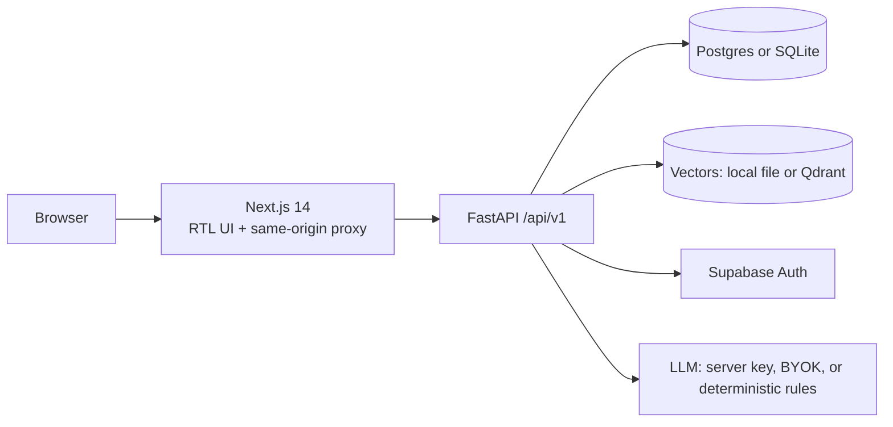

# Employee AI Search

An internal search engine for employee documents: upload PDF / DOCX / Markdown / TXT files, index them locally, and get **answers with citations** in Arabic and English. The interface is Arabic RTL; the backend is FastAPI.

**Live:** [Web app](https://employee-ai-search-web.onrender.com) · [Health check](https://employee-ai-search-api.onrender.com/api/v1/health)

---

## What it does

- **Ingestion** of PDF, DOCX, Markdown and TXT, including repaired visual-order text for RTL Arabic PDFs and removal of noisy tables of contents.
- **Hybrid search** (BM25 + vectors) with per-document retrieval, reranking, section expansion, and a query cache that is invalidated on every upload or delete. Each completed document gets its own top-K slot before the hits are merged, so a long dominant file cannot crowd out a short but decisive one; the query is embedded only once.
- **Cited answers**: every quote names the source file and page. A page number is either physical or taken from the document's authoritative `/PageLabels` — **never inferred from a number printed in the text**.
- **Honest abstention**: when the evidence is insufficient it says "I couldn't find an answer in the documents" instead of inventing one.
- **Accounts and auth** via Supabase Auth (or a local provider with no external service). There are two registration paths: an **employer** creates a workspace and receives a reusable invite link/code, and a **member** registers through that invite. There is no guest/demo access — everyone signs in. Password reset is available with Supabase.
- **Workspaces**: every document, chunk, query and user list is isolated per workspace. Members can only see and search their own workspace's content, even if they know another workspace's document id.
- **Roles**: any signed-in account can upload and search; **deleting documents and managing users are admin-only**, and replacing another user's document is admin-only. The employer who creates a workspace is its admin.
- **BYOK**: signed-in users may send their provider key in a request header. It is used for that request only and is never stored or logged. The server key is admin-only; non-admins receive `402` when it is required. A non-blocking hint suggests BYOK only when the free fallback is weak, and `REQUIRE_CHAT_BYOK=true` optionally makes the key mandatory for non-admin chat.
- **Two themes** (dark and light) with a persisted choice, and an RTL Arabic interface.
- **Workspace UI**: a responsive sidebar (Chat, Library, admin-only Users, Settings) with a
  full-page document library, user administration and settings, plus a mobile drawer. The
  visual system (blue primary, emerald accent, Inter / Noto Naskh Arabic) is inspired by a
  local design prototype, but every view is backed by the real API — no mock data or mock
  auth is used.

---

## Registration and workspaces

Registration has two paths, with no guest or demo account:

1. **Employer** — on the auth screen choose **Employer**, enter a workspace name
   and your details, and submit. You become the workspace **admin**. The app
   immediately shows an **invite code** and an invite URL
   (`/auth?invite=<code>`); copy and share it with your team.
2. **Member** — open the invite URL (the code is prefilled), enter your details,
   and submit. You join that workspace as a regular user.

Registration without a valid invite is rejected. The `INVITE_CODE` environment
variable remains only as a legacy fallback that lets members join the default
workspace. On startup the default workspace is created and any pre-existing rows
without a workspace are backfilled into it.

Every search, upload, delete and admin user query is scoped to the signed-in
principal's workspace, so one workspace can never read or modify another's data.
API keys resolve to the default workspace. `users.email` is globally unique.

---

## Architecture



The proxy at `frontend/app/api/v1/[...path]/route.ts` forwards cookies, `X-CSRF-Token`, and BYOK headers to the backend. It stores no keys.

---

## Run locally (no external services)

The defaults use SQLite, hashing vectors, and deterministic answers — no Supabase, Qdrant, or LLM key required.

```powershell
# Backend
cd backend
py -3 -m venv .venv
.\.venv\Scripts\Activate.ps1
pip install -r requirements.txt -r requirements-dev.txt
py -3 run.py                       # http://localhost:8000

# Frontend (in a second terminal)
cd frontend
npm install
npm run dev                        # http://localhost:3000
```

Development API keys: `dev-admin-key` (admin), `dev-user-key` (user), `dev-viewer-key` (viewer). When `ENVIRONMENT=production` these **default values are ignored** with a warning in the logs; set environment-specific keys instead.

---

## Key environment variables

| Variable | Default | Purpose |
|---|---|---|
| `DATABASE_URL` | empty → SQLite | **Use `postgresql://…:6543/postgres` when deploying.** Without it, data lives in `/tmp` and is wiped on redeploy |
| `AUTH_PROVIDER` | `supabase` if `SUPABASE_URL` is set, otherwise `local` | Identity provider |
| `SUPABASE_URL` / `SUPABASE_ANON_KEY` / `SUPABASE_SERVICE_ROLE_KEY` | empty | Supabase auth and user administration |
| `SUPABASE_JWT_SECRET` / `SUPABASE_JWKS_URL` | empty | Legacy HS256 verification or JWKS for ES256 |
| `INVITE_CODE` | empty | Legacy global invite fallback for members joining the default workspace. Normal invites are generated per workspace at registration |
| `DEFAULT_WORKSPACE_ID` | `ws_default` | Id of the startup workspace used to backfill legacy rows and API-key requests |
| `DEFAULT_WORKSPACE_NAME` | `Default workspace` | Display name of that startup workspace |
| `LLM_API_KEY` / `LLM_BASE_URL` / `LLM_MODEL` | empty / OpenAI / gpt-4o-mini | Server key (admin-only) |
| `LLM_BYOK_ENABLED` | `true` | Allow visitor-supplied keys |
| `REQUIRE_CHAT_BYOK` | `false` | When `true`, refuse keyless non-admin chat with the existing `402`; keep `false` for free/offline answers |
| `LLM_ALLOWED_BASE_URLS` | OpenAI / Groq / OpenRouter | Prevent pointing a key at an arbitrary host (SSRF) |
| `EMBEDDING_BACKEND` | `hashing` | Hosted default: instant, offline and free. BM25 leads retrieval and the LLM writes the cited answer. Optional: `gemini`, `hf-api`, `sentence-transformers` |
| `EMBEDDING_DIMENSION` | 384 | Width of the offline hashing vector. `gemini` uses 768 automatically; an explicit override still wins |
| `EMBEDDING_BATCH_SIZE` | 64 | Ingestion batch size; hashing is instant and API-backed backends stay bounded |
| `GEMINI_API_KEY` | empty | Optional Google AI Studio key for `gemini`; documents get `RETRIEVAL_DOCUMENT`, queries get `RETRIEVAL_QUERY`. Not needed by the default deployment |
| `HF_API_KEY` | empty | Legacy token for `hf-api`; Hugging Face now charges free accounts for Inference Providers, so the default stays offline |
| `QDRANT_URL` | empty | External vector store; falls back to a local file |
| `PER_DOCUMENT_TOP_K` | `5` | Hits requested from each completed document before the global merge |
| `RATE_LIMIT_AUTH_PER_MINUTE` | `10` | Per-IP bucket shared by login/register |
| `TRUST_PROXY_HEADERS` | `true` | Use the last `X-Forwarded-For` hop as the client IP. Keep this on behind Render; set `false` only when serving directly |
| `LOGIN_LOCK_MAX_FAILURES` | `5` | Failed logins per normalised email before a temporary account lock. Unknown emails count too |
| `LOGIN_LOCK_MINUTES` | `15` | Duration of that lock; a successful sign-in clears the counter |
| `ADMIN_EMAIL` / `ADMIN_PASSWORD` | empty | Bootstrap an admin at startup |

See `.env.example` and `specs/*` for the full list.

---

## API

All routes are under `/api/v1`. Authenticate with the session cookie or the `X-API-Key` header.

```powershell
# Health
curl http://localhost:8000/api/v1/health

# Search
curl -X POST http://localhost:8000/api/v1/search `
  -H "X-API-Key: dev-admin-key" -H "Content-Type: application/json" `
  -d '{"query":"annual leave","top_k":5}'

# Chat (cited answer)
curl -X POST http://localhost:8000/api/v1/chat `
  -H "X-API-Key: dev-admin-key" -H "Content-Type: application/json" `
  -d '{"message":"How many annual leave days do employees get?","stream":false,"language":"en"}'
```

BYOK headers (for requests using a visitor key only): `X-LLM-API-Key`, `X-LLM-Model`, `X-LLM-Base-URL`. OpenAPI docs are at `/docs`.

---

## Tests

```powershell
cd backend
$env:PYTHONIOENCODING="utf-8"
py -3 -m pytest -q          # 218 passed + 1 skipped (needs TEST_DATABASE_URL)

cd ../frontend
npm.cmd test                # 40 tests (Vitest + Testing Library)
npm run type-check
npm run lint
npm run build
```

Frontend tests cover theme persistence, the BYOK key lifecycle, the smart fallback hint and its localized copy, `402` handling and key-panel routing, streamed tokens and citations, the empty state, and the file-size / relative-time formatting helpers.

### Operator consistency checks

An interrupted upload can leave a document row, its chunk rows and its vectors
disagreeing. Two read-first commands live beside `scripts/seed.py`:

```powershell
# From the repository root, with the SAME env as the API.
py -3 scripts/verify_consistency.py                 # read-only; exit 1 if inconsistent
py -3 scripts/verify_consistency.py --json          # machine-readable report

py -3 scripts/reconcile_documents.py                # DRY RUN: prints the plan only
py -3 scripts/reconcile_documents.py --apply         # marks stale 'processing' rows as 'failed'
py -3 scripts/reconcile_documents.py --apply --purge-orphans --json
```

`verify_consistency` reports `chunks_count` mismatches, chunks whose document is
missing, orphan vectors, chunks with no vector and documents stuck in
`processing`. An unreadable vector store is a failed check, never a clean one.
`reconcile_documents` changes nothing until `--apply`; even then it only purges
orphans when `--purge-orphans` is also passed, and it only marks stale documents
as `failed` so an operator can delete and re-upload them. It never invents a
missing vector and never prints document text. Use the same `DATA_DIR`,
`DATABASE_URL` and `QDRANT_URL` as the running API.

---

## Evaluation (measured, not estimated)

From `eval/results.json` over 28 Arabic/English questions built from an academic document:

| Metric | Value |
|---|---|
| hit@1 / hit@3 / hit@5 | 10 / 15 / 16 out of 28 |
| MRR | 0.448 |
| Correct answer | 19 / 28 |
| Correct citation | 14 / 28 |
| Abstentions | 5 (4 of them unanswerable from the document) |

These are the free-mode numbers (BM25-led retrieval with offline hashing candidates, heuristic answers). A server LLM key or BYOK improves answer phrasing but not retrieval; these are not tuned lab results.

---

## Deploy on Render + Supabase

The hosted stack is **one manual Web Service card for the API** plus the existing Next.js web service. There is no embed service, no model download and no Blueprint requirement; set the secrets in the Render dashboard.

1. **New → Web Service** and connect `Ali-AlAli-9/employee-ai-search`, branch `main`.
2. Name it `employee-ai-search-api`; runtime **Docker**, **Free** plan, same region as the web service.
3. Leave **Root Directory** empty. **Dockerfile Path**: `backend/Dockerfile`. **Docker Context**: `backend`.
4. **Health Check Path**: `/api/v1/health/ready`.
5. Add the environment variables from `.env.example`. In particular:
   ```text
   ENVIRONMENT=production
   EMBEDDING_BACKEND=hashing
   EMBEDDING_DIMENSION=384
   DATABASE_URL=<Supabase transaction pooler URL, port 6543>
   ```
6. Keep the existing `employee-ai-search-web` card with `BACKEND_URL=https://employee-ai-search-api.onrender.com`.

In Supabase use **Project Settings → Database → Connection strings → Transaction pooler (port 6543)**. The code handles the placeholder brackets commonly found in Supabase URLs automatically.

Check `/api/v1/health`: it must report `"engine": "postgres"`, `"status": "healthy"` and `embedding_model.backend = "hashing"`. Upload documents from the UI — live seeding is user-driven.

The API uses offline `hashing` embeddings and BM25 for retrieval. `HASHING_VECTOR_WEIGHT=0` keeps the hashing vector out of the final score (BM25 leads, the vector only widens the candidate set); the LLM — the server key for admins, BYOK for everyone else — reads the cited chunks and decides the answer. There is no embedding provider key, no token balance, no RPM/TPM quota, no second service and nothing to prefetch at build time, so the single image fits Render's free plan comfortably. A previous two-service ONNX worker was retired after its quantised model repeatedly killed the 512 MB container mid-upload.

To verify after deploying:

```powershell
Invoke-RestMethod https://employee-ai-search-api.onrender.com/api/v1/health
```

It must answer with `backend: hashing`, model `hashing` and dimension `384`.

---

## Project structure

```
backend/app/          API, ingestion, search, agents, identity, security, db
backend/tests/        pytest suite
frontend/app/         Next.js pages, proxy and theme tokens (globals.css)
frontend/components/  AppShell + RTL chat components
frontend/components/views/  Chat, Library, Users, Settings, Auth views
frontend/lib/         api, auth, copy, format, llm, theme, types
specs/                001–012: specs, plans, tasks
scripts/              seed.py, evaluate.py, inspect_page_labels.py,
                      verify_consistency.py, reconcile_documents.py
eval/                 evaluation results
sample-data/          sample documents
```

---

## Known limitations (stated honestly)

- Without `DATABASE_URL`, data is temporary on Render (`/tmp`) and wiped on redeploy.
- Free mode uses hashing vectors, so retrieval quality is modest (numbers above).
- The Render free plan sleeps; the first request after idle can take a few seconds.
- `/PageLabels` is the only source of page labels; older documents show the physical page number.
- There is no local Postgres integration test unless `TEST_DATABASE_URL` is set.

---

## License

MIT — see `LICENSE`.
