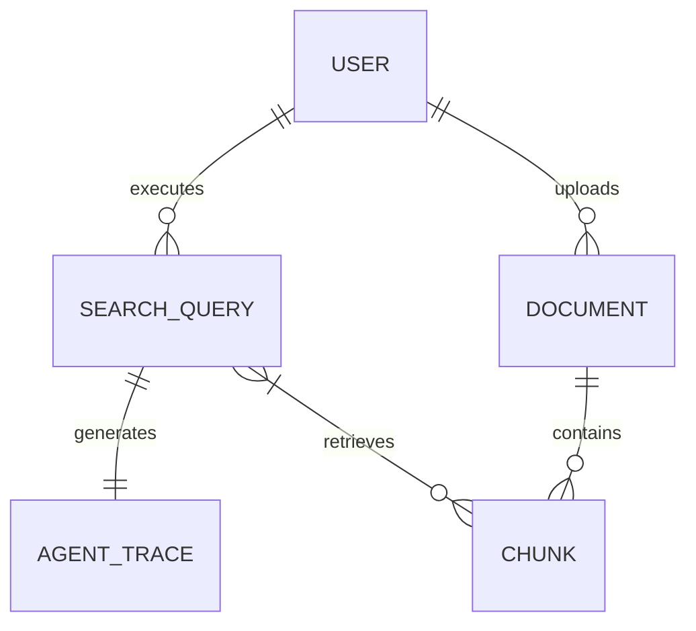

# Data Model: Employee AI Search Platform

**Branch**: `001-employee-ai-search-platform` | **Date**: 2026-11-13

## Entity Relationship Diagram



## Entities

### 1. User
Represents a system user with authentication and authorization.

| Field | Type | Constraints | Description |
|-------|------|-------------|-------------|
| id | UUID | PK, default gen_random_uuid() | Unique identifier |
| email | VARCHAR(255) | UNIQUE, NOT NULL | User email for identification |
| api_key_hash | VARCHAR(255) | NOT NULL | Bcrypt hash of API key |
| role | VARCHAR(20) | NOT NULL, DEFAULT 'user', CHECK IN ('admin', 'user', 'viewer') | Authorization role |
| is_active | BOOLEAN | NOT NULL, DEFAULT true | Account status |
| created_at | TIMESTAMPTZ | NOT NULL, DEFAULT now() | Registration timestamp |
| last_login | TIMESTAMPTZ | NULLABLE | Last successful authentication |

**Indexes**: `idx_user_email` (unique), `idx_user_api_key_hash`

**Roles**:
- `admin`: Full access - upload/delete documents, manage users, view analytics, use the deployment's LLM key
- `user`: Upload, search and chat (with a personal LLM key), view own history
- `viewer`: Upload, search and chat (with a personal LLM key); guests get this role

---

### 2. Document
Represents an uploaded file with processing metadata.

| Field | Type | Constraints | Description |
|-------|------|-------------|-------------|
| id | UUID | PK, default gen_random_uuid() | Unique identifier |
| filename | VARCHAR(500) | NOT NULL | Original filename |
| stored_filename | VARCHAR(500) | NOT NULL | Sanitized stored filename |
| content_type | VARCHAR(100) | NOT NULL | MIME type (application/pdf, etc.) |
| size_bytes | BIGINT | NOT NULL | File size in bytes |
| status | VARCHAR(20) | NOT NULL, DEFAULT 'pending', CHECK IN ('pending', 'processing', 'completed', 'failed') | Processing state |
| chunks_count | INTEGER | NOT NULL, DEFAULT 0 | Number of chunks created |
| error_message | TEXT | NULLABLE | Error details if failed |
| uploaded_by | UUID | FK → User.id, NOT NULL | Uploader reference |
| created_at | TIMESTAMPTZ | NOT NULL, DEFAULT now() | Upload timestamp |
| updated_at | TIMESTAMPTZ | NOT NULL, DEFAULT now() | Last status change |
| completed_at | TIMESTAMPTZ | NULLABLE | Processing completion time |

**Indexes**: `idx_document_uploaded_by`, `idx_document_status`, `idx_document_created_at`

**Status Transitions**: `pending` → `processing` → `completed` OR `failed`

---

### 3. Chunk
A text segment with vector embedding for semantic search.

| Field | Type | Constraints | Description |
|-------|------|-------------|-------------|
| id | UUID | PK, default gen_random_uuid() | Unique identifier |
| document_id | UUID | FK → Document.id, NOT NULL, ON DELETE CASCADE | Parent document |
| chunk_index | INTEGER | NOT NULL | Sequential index within document |
| text | TEXT | NOT NULL | Extracted text content |
| token_count | INTEGER | NOT NULL | Approximate token count |
| embedding | VECTOR(768) | NOT NULL | Vector embedding (pgvector) |
| metadata | JSONB | NOT NULL, DEFAULT '{}' | Flexible metadata: page_number, section_title, char_start, char_end |
| created_at | TIMESTAMPTZ | NOT NULL, DEFAULT now() | Creation timestamp |

**Indexes**: 
- `idx_chunk_document_id` (foreign key)
- `idx_chunk_embedding` (HNSW index for vector similarity via pgvector)
- `idx_chunk_metadata_gin` (GIN index for JSONB queries)

**Constraints**: Unique composite `(document_id, chunk_index)`

---

### 4. SearchQuery
Records a user search/chat query for analytics and history.

| Field | Type | Constraints | Description |
|-------|------|-------------|-------------|
| id | UUID | PK, default gen_random_uuid() | Unique identifier |
| query_text | TEXT | NOT NULL | User's natural language query |
| query_type | VARCHAR(20) | NOT NULL, DEFAULT 'chat', CHECK IN ('search', 'chat') | Query mode |
| user_id | UUID | FK → User.id, NOT NULL | Query owner |
| results_count | INTEGER | NOT NULL, DEFAULT 0 | Number of chunks retrieved |
| latency_ms | INTEGER | NOT NULL | End-to-end latency |
| agent_trace_id | UUID | FK → AgentTrace.id, NULLABLE | Link to agent execution trace |
| created_at | TIMESTAMPTZ | NOT NULL, DEFAULT now() | Query timestamp |

**Indexes**: `idx_search_query_user_id`, `idx_search_query_created_at`, `idx_search_query_type`

---

### 5. AgentTrace
Execution trace of the multi-agent pipeline for debugging and evaluation.

| Field | Type | Constraints | Description |
|-------|------|-------------|-------------|
| id | UUID | PK, default gen_random_uuid() | Unique identifier |
| query_id | UUID | FK → SearchQuery.id, NOT NULL, UNIQUE | Associated query |
| researcher_input | JSONB | NOT NULL | Input to researcher agent |
| researcher_output | JSONB | NOT NULL | Output from researcher agent |
| researcher_duration_ms | INTEGER | NOT NULL | Researcher execution time |
| researcher_status | VARCHAR(20) | NOT NULL, CHECK IN ('success', 'error') | Researcher status |
| retriever_input | JSONB | NOT NULL | Input to retriever agent |
| retriever_output | JSONB | NOT NULL | Output from retriever agent |
| retriever_duration_ms | INTEGER | NOT NULL | Retriever execution time |
| retriever_status | VARCHAR(20) | NOT NULL, CHECK IN ('success', 'error') | Retriever status |
| synthesizer_input | JSONB | NOT NULL | Input to synthesizer agent |
| synthesizer_output | JSONB | NOT NULL | Output from synthesizer agent |
| synthesizer_duration_ms | INTEGER | NOT NULL | Synthesizer execution time |
| synthesizer_status | VARCHAR(20) | NOT NULL, CHECK IN ('success', 'error') | Synthesizer status |
| created_at | TIMESTAMPTZ | NOT NULL, DEFAULT now() | Trace timestamp |

**Indexes**: `idx_agent_trace_query_id` (unique)

---

### 6. ChatMessage (Frontend-only, persisted in SearchQuery.agent_trace.synthesizer_output)

For chat history display, messages are stored within the agent trace output. No separate table needed for v1.

---

## Qdrant Vector Store Schema

**Collection**: `documents_chunks`

| Field | Type | Description |
|-------|------|-------------|
| id | UUID | Matches Chunk.id (point ID) |
| vector | Float[768] | Embedding vector |
| payload.document_id | UUID | Foreign key to Document |
| payload.chunk_index | Integer | Sequential index |
| payload.text | String | Chunk text (truncated for payload) |
| payload.token_count | Integer | Token count |
| payload.metadata | Object | Full metadata from Chunk.metadata |
| payload.created_at | String (ISO8601) | Creation timestamp |

**Index Configuration**:
- HNSW index: `m=16, ef_construct=100`
- Distance: Cosine
- Quantization: Scalar (int8) for memory efficiency on free tier
- Payload indexes: `document_id` (keyword), `chunk_index` (integer)

---

## Embedding Model Specifications

| Model | Dimensions | Max Tokens | Language Support | RAM (approx) |
|-------|------------|------------|------------------|--------------|
| `sentence-transformers/all-MiniLM-L6-v2` | 384 | 256 | English + 50+ languages | ~90 MB |
| `BAAI/bge-small-en-v1.5` | 384 | 512 | English | ~130 MB |
| `intfloat/multilingual-e5-small` | 384 | 512 | 100+ languages (incl. Arabic) | ~130 MB |

**Decision**: `intfloat/multilingual-e5-small` for Arabic support + multilingual capability. 384 dimensions reduces Qdrant memory by 50% vs 768-dim models.

---

## PostgreSQL Extensions Required

```sql
-- Enable UUID generation
CREATE EXTENSION IF NOT EXISTS "uuid-ossp";

-- Enable pgvector for embeddings (optional - primary vectors in Qdrant)
CREATE EXTENSION IF NOT EXISTS "vector";

-- Enable GIN for JSONB indexing
CREATE EXTENSION IF NOT EXISTS "btree_gin";
```

---

## Migration Strategy

1. **Initial Migration**: Create all tables with indexes
2. **Seed Data**: Create default admin user (via environment variable)
3. **Versioning**: Use Alembic for schema migrations
4. **Rollback**: Each migration must be reversible

---

## Data Retention Policies

| Entity | Retention | Archive Strategy |
|--------|-----------|------------------|
| Document | Indefinite | Soft delete (status=archived) |
| Chunk | Indefinite | Cascade with document |
| SearchQuery | 90 days | Partition by month, archive to cold storage |
| AgentTrace | 90 days | Partition by month, sample 10% for long-term |
| User | Indefinite | Soft delete (is_active=false) |

---

## Privacy & Compliance

- No PII in chunk text beyond what's in uploaded documents
- API keys hashed with bcrypt (cost factor 12)
- Email stored for account recovery only
- Search queries logged for analytics (anonymized after 30 days)
- Right to deletion: User can request full data purge (GDPR Art. 17)